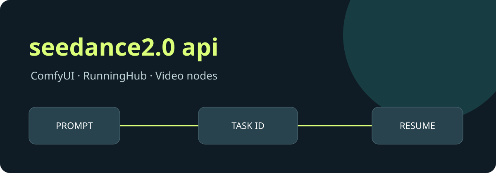
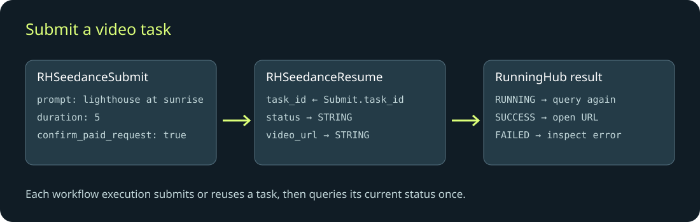
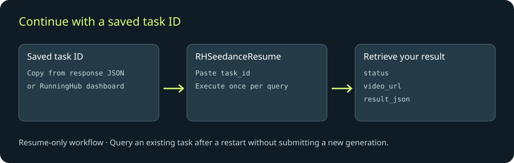

# seedance2.0 api · ComfyUI Video Relay



[简体中文](README.md) · [English](README.en.md) · [日本語](README.ja.md)

Submit Seedance 2.0 text-to-video jobs through RunningHub from ComfyUI, then retrieve results using the task ID. Designed for node workflows that use cloud video generation.

[Capabilities and limits](#s0) · [Installation](#s1) · [Your first video task](#s2) · [Node reference](#s3) · [Resume an existing task](#s4) · [Requests and data flow](#s5) · [Troubleshooting](#s6) · [References](#s7)

<a id="s0"></a>

## Capabilities and limits

Implemented settings are text-to-video, 4–15 seconds, 720p and 16:9. Mock API checks passed. Full ComfyUI loading and real paid generation remain unverified. Image-to-video, automatic polling, downloading and batch orchestration are not implemented.

<a id="s1"></a>

## Installation

Copy the entire project folder into an existing ComfyUI custom_nodes directory. The plugin uses only the Python standard library. No additional packages or model downloads are required. Use the Python environment that runs ComfyUI.

```text
ComfyUI/
├── main.py
└── custom_nodes/
    └── comfyui-seedance2-api/
        ├── __init__.py
        └── nodes.py
```

Open a terminal in the ComfyUI root, set your RunningHub API key, then start ComfyUI. The process must inherit the variable. The plugin does not load .env files. For Windows portable installations, set the variable in PowerShell and run your existing launcher in that same window.

### macOS / Linux

```bash
export RUNNINGHUB_API_KEY="your-runninghub-api-key"
python main.py
```

### Windows PowerShell

```powershell
$env:RUNNINGHUB_API_KEY="your-runninghub-api-key"
python main.py
```


<a id="s2"></a>

## Your first video task



Node connection illustration, not a runtime screenshot.

1. Search for RHSeedanceSubmit and RHSeedanceResume under RunningHub/Seedance.
2. Connect Submit.task_id to Resume.task_id. Submit must feed this output node to execute as part of the graph.
3. Enter a prompt, start with 5 seconds, set confirm_paid_request to true and run the workflow.
4. A finished ComfyUI execution means submission and one query finished. RUNNING means the remote job continues. Save taskId from the response JSON.
5. On success, open video_url in a browser to save the video. The output is a URL string. This version has no built-in player or download node.

```text
A slow camera push toward a small lighthouse on a rocky coast at sunrise.
Gentle waves, warm light, continuous shot, natural motion.
```

<a id="s3"></a>

## Node reference

### RHSeedanceSubmit

| Parameter / output | Type | Meaning |
|---|---|---|
| `prompt` | `STRING` | Required, non-empty video description |
| `duration` | `INT` | Seconds; default 5, range 4–15 |
| `confirm_paid_request` | `BOOLEAN` | Defaults to false; enable to submit a paid job |
| `task_id →` | `STRING` | Remote task ID returned by submission |

### RHSeedanceResume

| Parameter / output | Type | Meaning |
|---|---|---|
| `task_id` | `STRING` | An existing RunningHub task ID |
| `status →` | `STRING` | Remote status; UNKNOWN if absent |
| `video_url →` | `STRING` | URL of the first result; usually empty while pending |
| `result_json →` | `STRING` | Full response JSON; save taskId when present |


<a id="s4"></a>

## Resume an existing task



Create a workflow containing only RHSeedanceResume and paste the saved task ID. Each execution queries once. Wait and run it again until SUCCESS. Polling is manual. You can retrieve the same remote task after restarting ComfyUI.

ComfyUI may cache the submit node. Input changes, a restart or cache invalidation can execute it again. Use a Resume-only workflow to keep checking an existing task. Running Submit with a changed prompt or duration creates a new task.

<a id="s5"></a>

## Requests and data flow

| POST | JSON |
|---|---|
| `/rhart-video/sparkvideo-2.0/text-to-video` | `prompt`, `duration`, `resolution`, `ratio` |
| `/query` | `taskId` |

Base URL: `https://www.runninghub.cn/openapi/v2`  
Authorization: `Bearer <RUNNINGHUB_API_KEY>`

```json
{
  "prompt": "A lighthouse at sunrise, slow camera push.",
  "duration": "5",
  "resolution": "720p",
  "ratio": "16:9"
}
```

[RunningHub API](https://pre.runninghub.cn/runninghub-api-doc-en/api-494859271)

The key is read from the environment. Prompts are sent to RunningHub, which hosts the results. Node outputs do not include the key. Save the task ID and download your result files promptly.

<a id="s6"></a>

## Troubleshooting

### Nodes are missing

Check the folder layout and import errors in the startup log. Restart ComfyUI.

### Missing API key

Set RUNNINGHUB_API_KEY in the terminal that launches ComfyUI.

### HTTP 401 / 403

Check the account, API key and endpoint permissions.

### RUNNING with an empty URL

Wait and query the same task ID again.

### FAILED or provider error

The node raises an error. Inspect the task in RunningHub.

### Submission times out or returns no taskId

Check the RunningHub dashboard before resubmitting. Each request has a 90-second timeout.

### No visible text preview

Connect string outputs to a compatible text display node, or inspect execution history. This plugin does not include a frontend text preview extension.

## Commercial partnership · Sponsor

<p align="center"><a href="https://www.runninghub.ai/call-api?source=github"></a></p>

<h3 align="center">RunningHub API</h3>

Access **400+ leading AI models** via API — Seedance, Kling, MiniMax, Nano Banana, Veo, and more — at highly competitive prices.

**High-Concurrency Support · Free API Testing · End-to-End Encryption**

- Deep discounts on full-capability Seedance API access. Online tools start at **CNY 0.21 per second**, with **60%–80% cost savings**.
- Stable, high-concurrency service with flexible pay-as-you-go billing, no bundled commitments, no queues, and no random access allocation.
- Online tools including an infinite canvas, ComfyUI, and agents cover production from script to finished video.
- One-stop access to LLM APIs, multimodal APIs, workflow APIs, and AI applications.
- Choose from **400+ mainstream models** and **8,000+ versions**, with access to international editions.
- Trusted by thousands of enterprises and used by **5 million monthly active consumers**.

This project is supported by RunningHub, connecting you to 400+ leading models through a single API.

**[Test the API for Free](https://www.runninghub.ai/call-api?source=github)**

Contact [zhenyuedong@haima.me](mailto:zhenyuedong@haima.me) for RunningHub discounts and free testing.


<a id="s7"></a>

## References

[Acly / comfyui-inpaint-nodes](https://github.com/Acly/comfyui-inpaint-nodes) · [Acly / comfyui-tooling-nodes](https://github.com/Acly/comfyui-tooling-nodes)

The documentation follows their node-by-node organization, input/output descriptions and workflow examples. This project is implemented independently.

[Research](RESEARCH.md)

