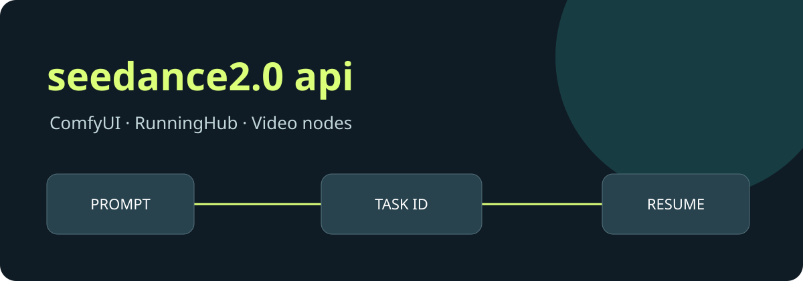
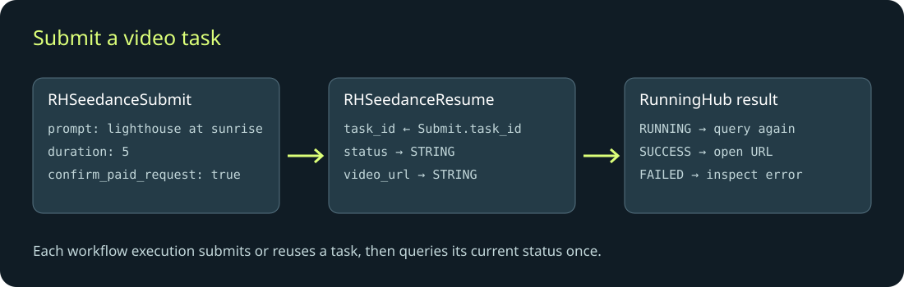
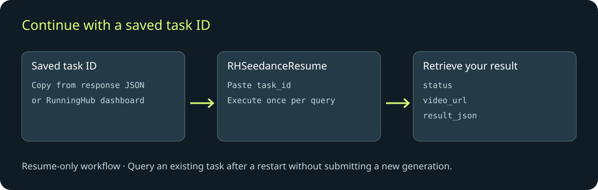

# seedance2.0 api · ComfyUI Video Relay



[简体中文](README.md) · [English](README.en.md) · [日本語](README.ja.md)

ComfyUI から RunningHub 経由で Seedance 2.0 のテキスト動画生成を実行し、タスク ID で結果を取得するノード集です。クラウドでの動画生成をノードワークフローに組み込めます。

[機能と対応範囲](#s0) · [インストールと設定](#s1) · [最初の動画生成](#s2) · [ノード仕様](#s3) · [既存タスクの再開](#s4) · [リクエストとデータの流れ](#s5) · [トラブルシューティング](#s6) · [参考プロジェクト](#s7)

<a id="s0"></a>

## 機能と対応範囲

対応範囲はテキスト動画生成、4〜15 秒、720p、16:9 固定です。模擬 API テストは完了しています。ComfyUI 全体での読み込みと実際の有料生成は未検証です。画像動画生成、自動ポーリング、ダウンロード、バッチ処理は未実装です。

<a id="s1"></a>

## インストールと設定

プロジェクトのフォルダー全体を既存の ComfyUI の custom_nodes にコピーします。Python 標準ライブラリのみを使用します。追加パッケージやモデルのダウンロードは不要です。ComfyUI を実行する Python 環境を使用してください。

```text
ComfyUI/
├── main.py
└── custom_nodes/
    └── comfyui-seedance2-api/
        ├── __init__.py
        └── nodes.py
```

ComfyUI のルートディレクトリでターミナルを開き、RunningHub の API キーを設定して起動します。ComfyUI のプロセスが環境変数を引き継ぐ必要があります。.env の自動読み込みはありません。Windows ポータブル版では、同じ PowerShell ウィンドウで変数を設定して通常の起動スクリプトを実行します。

### macOS / Linux

```bash
export RUNNINGHUB_API_KEY="your-runninghub-api-key"
python main.py
```

### Windows PowerShell

```powershell
$env:RUNNINGHUB_API_KEY="your-runninghub-api-key"
python main.py
```


<a id="s2"></a>

## 最初の動画生成



ノード接続の模式図です。実行画面のスクリーンショットではありません。

1. RunningHub/Seedance カテゴリから RHSeedanceSubmit と RHSeedanceResume を追加します。
2. Submit の task_id を Resume の task_id に接続します。Submit はこの出力ノードに接続するとワークフローの実行対象になります。
3. プロンプトを入力し、まずは 5 秒を指定します。confirm_paid_request を true にして実行します。
4. ComfyUI の実行終了は送信と一度の照会が完了したことを示します。RUNNING なら生成中です。応答 JSON の taskId を保存してください。
5. 成功後、video_url をブラウザで開いて動画を保存します。出力は URL 文字列です。動画プレーヤーやダウンロードノードは含まれていません。

```text
A slow camera push toward a small lighthouse on a rocky coast at sunrise.
Gentle waves, warm light, continuous shot, natural motion.
```

<a id="s3"></a>

## ノード仕様

### RHSeedanceSubmit

| パラメーター / 出力 | 型 | 説明 |
|---|---|---|
| `prompt` | `STRING` | 必須の動画プロンプト。空文字列は不可 |
| `duration` | `INT` | 秒数。初期値 5、範囲 4〜15 |
| `confirm_paid_request` | `BOOLEAN` | 初期値 false。有料生成を送信するには true |
| `task_id →` | `STRING` | 送信時に返されるタスク ID |

### RHSeedanceResume

| パラメーター / 出力 | 型 | 説明 |
|---|---|---|
| `task_id` | `STRING` | 既存の RunningHub タスク ID |
| `status →` | `STRING` | リモートの状態。値がない場合は UNKNOWN |
| `video_url →` | `STRING` | 最初の結果の URL。生成中は通常空 |
| `result_json →` | `STRING` | 応答全体の JSON。taskId が含まれる場合は保存 |


<a id="s4"></a>

## 既存タスクの再開



RHSeedanceResume だけを配置したワークフローを作り、保存したタスク ID を入力します。一回の実行につき一回照会します。時間を置いて SUCCESS になるまで再実行してください。ポーリングは手動です。ComfyUI の再起動後も同じタスクを照会できます。

ComfyUI は Submit の結果をキャッシュすることがあります。入力変更、再起動、キャッシュの無効化によって再送信される場合があります。既存タスクの照会には Resume だけのワークフローを使用してください。プロンプトや秒数を変更して Submit を実行すると新しいタスクが作成されます。

<a id="s5"></a>

## リクエストとデータの流れ

| POST | JSON |
|---|---|
| `/rhart-video/sparkvideo-2.0/text-to-video` | `prompt`, `duration`, `resolution`, `ratio` |
| `/query` | `taskId` |

Base URL: `https://www.runninghub.cn/openapi/v2`  
Authorization: `Bearer <RUNNINGHUB_API_KEY>`

```json
{
  "prompt": "A lighthouse at sunrise, slow camera push.",
  "duration": "5",
  "resolution": "720p",
  "ratio": "16:9"
}
```

[RunningHub API](https://pre.runninghub.cn/runninghub-api-doc-en/api-494859271)

キーは環境変数から読み取ります。プロンプトは RunningHub に送信され、結果は同サービスで配信されます。ノード出力にキーは含まれません。タスク ID を保存し、結果ファイルをダウンロードしてください。

<a id="s6"></a>

## トラブルシューティング

### ノードが見つからない

フォルダー構成と起動ログの読み込みエラーを確認して再起動します。

### API キーが未設定

ComfyUI を起動するターミナルで RUNNINGHUB_API_KEY を設定します。

### HTTP 401 / 403

アカウント、キー、API の利用権限を確認します。

### RUNNING で URL が空

しばらく待ち、同じタスク ID で照会します。

### FAILED またはサービスエラー

ノードがエラーを返します。RunningHub のタスク詳細を確認します。

### 送信タイムアウト / taskId がない

再送信の前に管理画面でタスクの有無を確認します。リクエストのタイムアウトは 90 秒です。

### テキストが表示されない

文字列出力を対応するテキスト表示ノードに接続するか、実行履歴を確認します。このプラグインにフロントエンド表示拡張は含まれていません。

## 商業提携 · スポンサー

<p align="center"><a href="https://www.runninghub.ai/call-api?source=github"></a></p>

<h3 align="center">RunningHub API</h3>

Seedance、Kling、MiniMax、Nano Banana、Veo など、**400 種類以上の主要 AI モデル**を、競争力のある価格で API 経由で利用できます。

**高並列処理に対応 · 無料 API テスト · エンドツーエンド暗号化**

- フル機能の Seedance API を大幅割引で提供。オンラインツールは **1 秒あたり 0.21 人民元から**、**60〜80% のコスト削減**を実現。
- 安定した高並列処理と柔軟な従量課金。必要な分だけチャージでき、セット契約、待ち行列、抽選式の利用枠は不要。
- 無限キャンバス、ComfyUI、Agent などのオンラインツールで、脚本から完成映像まで制作を支援。
- LLM API、マルチモーダル API、ワークフロー API、AI アプリにワンストップでアクセス。
- **400 種類以上の主要モデル、8,000 以上のバージョン**から選択可能。国際版へのアクセスにも対応。
- 数千社の企業に信頼され、**月間アクティブユーザー 500 万人**の利用実績。

本プロジェクトは RunningHub の支援を受けています。単一の API で 400 種類以上の主要モデルに接続できます。

**[API を無料で試す](https://www.runninghub.ai/call-api?source=github)**

RunningHub の割引・無料テストのお問い合わせは [zhenyuedong@haima.me](mailto:zhenyuedong@haima.me) まで。


<a id="s7"></a>

## 参考プロジェクト

[Acly / comfyui-inpaint-nodes](https://github.com/Acly/comfyui-inpaint-nodes) · [Acly / comfyui-tooling-nodes](https://github.com/Acly/comfyui-tooling-nodes)

ノード別の説明、入出力仕様、接続例という文書構成を参考にしています。コードは独立した実装です。

[Research](RESEARCH.md)

