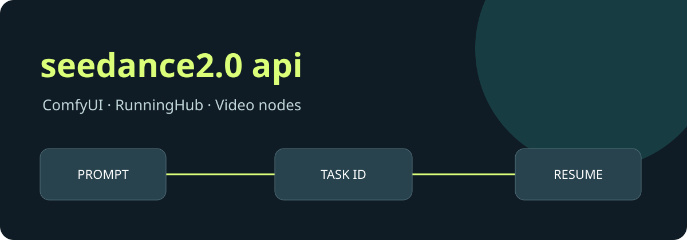
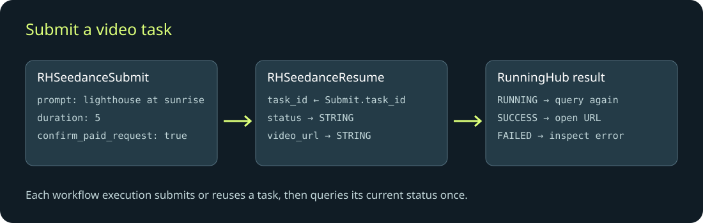
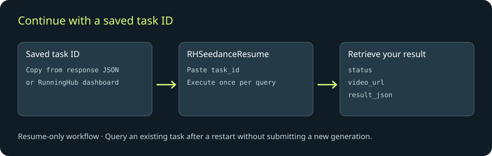

# seedance2.0 api · ComfyUI Video Relay



[简体中文](README.md) · [English](README.en.md) · [日本語](README.ja.md)

在 ComfyUI 中通过 RunningHub 提交 Seedance 2.0 文生视频任务，并用任务 ID 继续查询结果。适合希望把云端视频生成接入节点工作流的用户。

[功能与边界](#s0) · [安装与配置](#s1) · [第一个视频任务](#s2) · [节点参考](#s3) · [恢复已有任务](#s4) · [请求与数据流](#s5) · [常见问题](#s6) · [参考项目](#s7)

<a id="s0"></a>

## 功能与边界

当前实现支持 4–15 秒、固定 720p 与 16:9 文生视频。已做模拟接口检查，完整 ComfyUI 环境加载和真实付费生成尚未验证。图生视频、自动轮询、自动下载与批量编排尚未实现。

<a id="s1"></a>

## 安装与配置

将整个项目文件夹复制到已有 ComfyUI 的 custom_nodes 目录。插件只使用 Python 标准库，无需额外安装依赖或下载模型。请使用运行 ComfyUI 的 Python 环境。

```text
ComfyUI/
├── main.py
└── custom_nodes/
    └── comfyui-seedance2-api/
        ├── __init__.py
        └── nodes.py
```

在 ComfyUI 根目录打开终端，配置 RunningHub API Key 后启动。环境变量必须由 ComfyUI 进程继承，插件不会自动读取 .env 文件。Windows 便携版用户可在同一 PowerShell 窗口设置变量后运行原有启动脚本。

### macOS / Linux

```bash
export RUNNINGHUB_API_KEY="your-runninghub-api-key"
python main.py
```

### Windows PowerShell

```powershell
$env:RUNNINGHUB_API_KEY="your-runninghub-api-key"
python main.py
```


<a id="s2"></a>

## 第一个视频任务



节点连接示意图，非运行截图。

1. 在节点搜索中添加 RHSeedanceSubmit 和 RHSeedanceResume，分类为 RunningHub/Seedance。
2. 将 Submit 的 task_id 输出连接到 Resume 的 task_id 输入。Submit 需要连接到此输出节点才会随工作流执行。
3. 填写提示词，先用默认 5 秒时长，将 confirm_paid_request 设为 true，再执行工作流。
4. 执行结束只代表本次提交和查询完成。若 status 为 RUNNING，远端仍在生成。保存返回 JSON 中的 taskId。
5. 生成成功后复制 video_url 到浏览器打开并保存视频。输出为字符串 URL，当前版本没有内置视频播放器或下载节点。

```text
A slow camera push toward a small lighthouse on a rocky coast at sunrise.
Gentle waves, warm light, continuous shot, natural motion.
```

<a id="s3"></a>

## 节点参考

### RHSeedanceSubmit

| 参数 / 输出 | 类型 | 含义 |
|---|---|---|
| `prompt` | `STRING` | 视频描述，必填且不能为空 |
| `duration` | `INT` | 秒数，默认 5，范围 4–15 |
| `confirm_paid_request` | `BOOLEAN` | 默认 false，设为 true 才提交付费生成 |
| `task_id →` | `STRING` | 提交返回的远端任务编号 |

### RHSeedanceResume

| 参数 / 输出 | 类型 | 含义 |
|---|---|---|
| `task_id` | `STRING` | 已有 RunningHub 任务编号 |
| `status →` | `STRING` | 远端状态，缺失时为 UNKNOWN |
| `video_url →` | `STRING` | results 中第一个结果的 URL；未产出时通常为空 |
| `result_json →` | `STRING` | 完整响应 JSON，包含 taskId 时应保存 |


<a id="s4"></a>

## 恢复已有任务



新建仅包含 RHSeedanceResume 的工作流，在 task_id 中粘贴已保存的 ID。每执行一次只查询一次状态。等待片刻后再次执行，直到 SUCCESS；不会自动轮询。这样在重启 ComfyUI 后也能查询同一远端任务。

连接提交节点的工作流可能复用 ComfyUI 的缓存；修改输入、重启或缓存失效都可能重新执行提交。需要继续查询时，使用仅含 Resume 的工作流。改变提示词或时长后执行 Submit 会创建新任务。

<a id="s5"></a>

## 请求与数据流

| POST | JSON |
|---|---|
| `/rhart-video/sparkvideo-2.0/text-to-video` | `prompt`, `duration`, `resolution`, `ratio` |
| `/query` | `taskId` |

Base URL: `https://www.runninghub.cn/openapi/v2`  
Authorization: `Bearer <RUNNINGHUB_API_KEY>`

```json
{
  "prompt": "A lighthouse at sunrise, slow camera push.",
  "duration": "5",
  "resolution": "720p",
  "ratio": "16:9"
}
```

[RunningHub API](https://pre.runninghub.cn/runninghub-api-doc-en/api-494859271)

密钥从运行环境读取。提示词发送到 RunningHub，结果由其托管。节点输出中不包含密钥。请保存 task_id，及时下载结果文件。

<a id="s6"></a>

## 常见问题

### 找不到节点

检查目录层级及启动日志中的导入错误，再重启 ComfyUI。

### 缺少 API Key

在启动 ComfyUI 的同一个终端设置 RUNNINGHUB_API_KEY。

### HTTP 401 / 403

检查 RunningHub 账号、密钥与接口权限。

### RUNNING 且 URL 为空

等待后用同一个 ID 再查询。

### FAILED 或服务端错误

节点会抛出错误。查看 RunningHub 控制台的任务详情。

### 提交超时或没有 taskId

先到 RunningHub 控制台核对是否已创建任务，避免重复提交。请求超时为 90 秒。

### 没有可见的文本预览

字符串可接入兼容的文本显示节点，或从 ComfyUI 执行历史中查看输出。当前插件未提供前端文本预览扩展。

## 商业合作 · 赞助支持

<p align="center"><a href="https://www.runninghub.ai/call-api?source=github"></a></p>

<h3 align="center">RunningHub API</h3>

通过 API 接入 Seedance、Kling、MiniMax、Nano Banana、Veo 等 **400+ 主流模型**，享受极具竞争力的价格。

**高并发支持 · 免费 API 测试 · 端到端加密**

- Seedance 满血版 API 接入全网骨折价，在线工具低至 **0.21 元/秒**，节省 **60%–80% 成本**！
- 超稳定高并发高折扣，随用随充按需弹性付费，不捆绑不排队不抽卡。
- 无限画布、ComfyUI、Agent 等在线工具，从剧本到成片全链路制作。
- 一站式接入 LLM API、多模态 API、工作流 API、AI 应用。
- **400+ 主流模型**（支持国际版权限），**8000+ 版本**任选。
- 数千家企业信赖，**500 万 C 端月活**验证。

本项目由 RunningHub 提供支持，单一接口直连 400+ 主流大模型。

**[免费测试 API](https://www.runninghub.ai/call-api?source=github)**

RunningHub 折扣获取与免费测试联系 [zhenyuedong@haima.me](mailto:zhenyuedong@haima.me)。


<a id="s7"></a>

## 参考项目

[Acly / comfyui-inpaint-nodes](https://github.com/Acly/comfyui-inpaint-nodes) · [Acly / comfyui-tooling-nodes](https://github.com/Acly/comfyui-tooling-nodes)

文档参考其按节点介绍功能、说明输入输出并提供连接示例的编排方式。项目代码独立实现。

[Research](RESEARCH.md)

